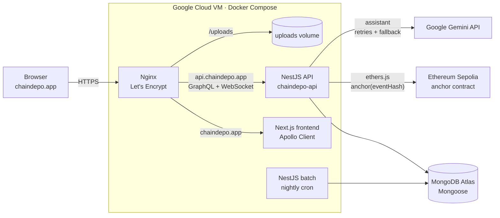
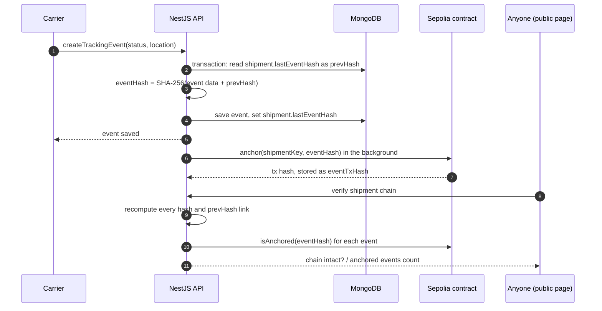

# ChainDepo — Backend (NestJS · GraphQL · MongoDB · Ethereum)

Backend for **[ChainDepo](https://chaindepo.app)**, a shipment-tracking platform for freight across Korea where every tracking event is **SHA-256 hash-chained** and **anchored on Ethereum Sepolia**, so anyone can verify that a shipment's history was not changed.

Frontend: [mirzayv/chaindepo-next](https://github.com/mirzayv/chaindepo-next) · Live: https://chaindepo.app

## Features
- **Shipments & tracking events** — shippers create shipments, carriers add status events (picked up, in transit, delivered …).
- **Hash chain** — each event stores the SHA-256 hash of its data plus the previous event's hash; changing any event breaks the chain.
- **On-chain anchoring** — event hashes are written to a smart contract on **Ethereum Sepolia** with `ethers.js`; the frontend shows the transaction for verification.
- **AI assistant** — a shipment Q&A assistant on **Google Gemini**, with retries and an automatic fallback model.
- **Real-time** — WebSocket gateway for live chat / notifications.
- **Members & roles** — users, carriers and admins; JWT auth, bcrypt password hashing, validated DTOs.
- **Community** — board articles, comments, likes, follows and view counts; image uploads (`graphql-upload`).
- **Batch jobs** — a separate NestJS app with nightly `@nestjs/schedule` cron jobs that recompute top shipments and top carriers.

## Architecture


### How a tracking event becomes verifiable

Changing any stored event changes its hash, which breaks the link to the next event and no longer matches the hash anchored on Ethereum.

## Tech stack
| Area | Tools |
|---|---|
| Framework | NestJS (monorepo: `chaindepo-api` + `chaindepo-batch`), TypeScript |
| API | GraphQL (Apollo Server, code-first), WebSocket (`ws`) |
| Data | MongoDB Atlas, Mongoose |
| Blockchain | ethers.js, Ethereum Sepolia |
| AI | Google Gemini API (via `@nestjs/axios`) |
| Auth | JWT, bcryptjs, class-validator |
| DevOps | Docker, Docker Compose, Nginx (HTTPS, Let's Encrypt), Google Cloud VM |

## Structure
```
apps/
  chaindepo-api/      GraphQL API, WebSocket gateway
    src/components/   shipment, tracking-event, blockchain, assistant, member, auth,
                      board-article, comment, like, follow, view
  chaindepo-batch/    nightly cron jobs (top shipments / carriers)
deploy/nginx/         nginx template (API + frontend + uploads, HTTPS)
docker-compose.yml    production stack: api + batch + next + nginx
docs/                 decisions, migration notes and the deployment guide
```

## Run locally
```bash
npm install
# create .env (see docs/COMPLETED_TASKS.md for the variable list) — never commit it
npm run start:dev            # API on http://localhost:3007/graphql
npm run start:dev:batch      # batch app (if needed)
```

## Deployment
Production runs on a Google Cloud VM with Docker Compose: `api`, `batch`, the Next.js frontend and `nginx` with Let's Encrypt certificates. Secrets live only in the server's `.env`. See the deployment guide in `docs/COMPLETED_TASKS.md`.

## AI-assisted development
This project was built with AI coding tools (Claude Code); the working rules and decisions are kept in `AGENTS.md`, `CLAUDE.md` and `docs/`.
